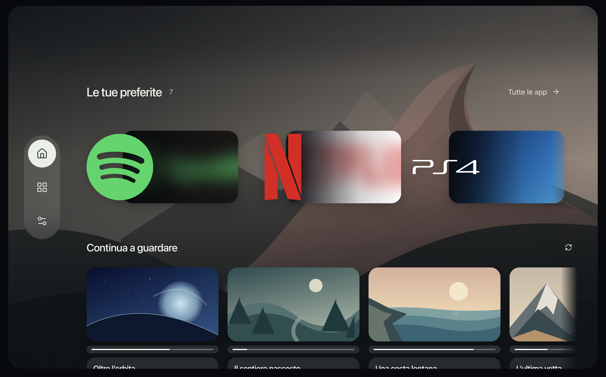
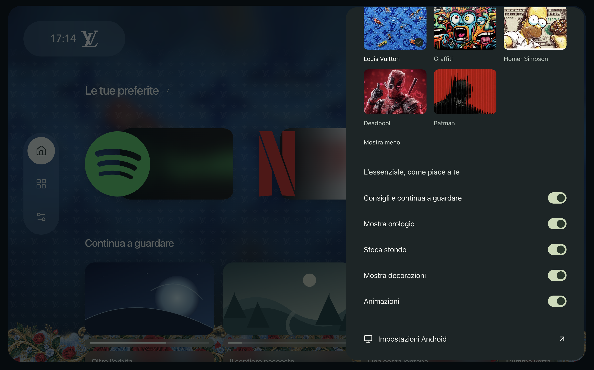
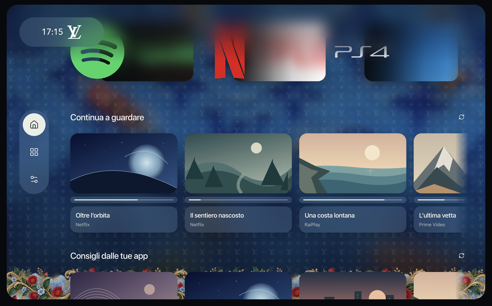
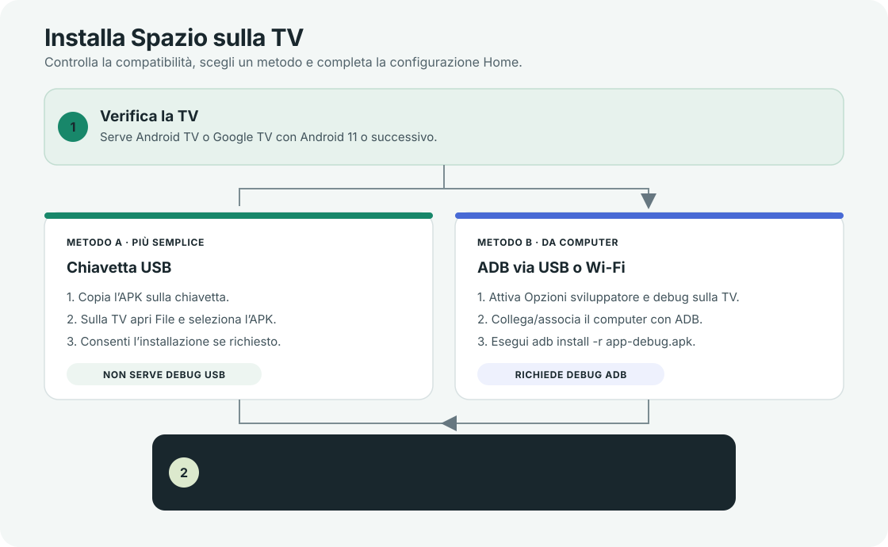
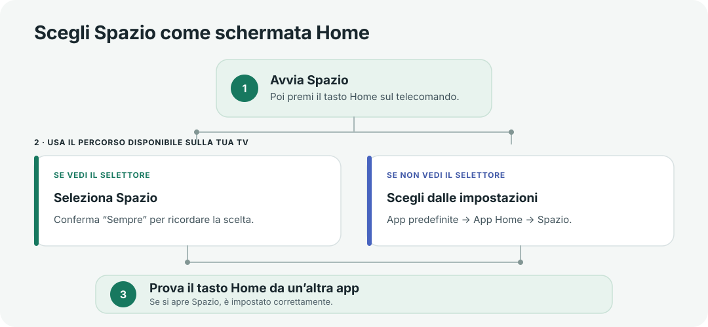

# Spazio


**Un launcher alternativo per Android TV e Google TV.** Riunisce le tue app preferite,
i collegamenti agli ingressi disponibili e i contenuti condivisi dalle app installate.
La schermata web è inclusa nell’app: per avviarla sulla TV non serve tenere acceso il computer.

## Anteprima

<p align="center">
  
  
</p>
<p align="center"><sub>Home e impostazioni</sub></p>

<p align="center">
  
  
</p>
<p align="center"><sub>Temi Minecraft e Louis Vuitton</sub></p>

> [!IMPORTANT]
> Spazio richiede **Android TV o Google TV con Android 11 o successivo**. Il sistema
> operativo dipende dal modello, non solo dalla marca. Non installare questo APK su
> Samsung Tizen, LG webOS, Fire TV o televisori Android con una versione precedente ad Android 11.

## Indice

- [Installazione in breve](#installazione-in-breve)
- [Prima di iniziare](#prima-di-iniziare)
- [Metodo A — chiavetta USB](#metodo-a--chiavetta-usb-consigliato)
- [Metodo B — ADB via USB o Wi-Fi](#metodo-b--adb-via-usb-o-wi-fi)
- [Imposta Spazio come Home principale](#imposta-spazio-come-home-principale)
- [Caso speciale: MiTV-MSSP2](#caso-speciale-mitv-mssp2)
- [Problemi comuni](#problemi-comuni)
- [Crea il pacchetto `Spazio.apk`](#crea-il-pacchetto-spazioapk)
- [Pubblica l’APK per il download](#pubblica-lapk-per-il-download)
- [Sviluppo e architettura](#sviluppo-e-architettura)

## Installazione in breve



La chiavetta USB è il percorso più semplice e non richiede di attivare le opzioni sviluppatore.
Se preferisci installare da computer, usa ADB: puoi collegare la TV via USB oppure via rete,
se il firmware offre il debug wireless.

## Prima di iniziare

- Una TV o un dispositivo collegato alla TV con **Android TV / Google TV 11+**.
- L’APK di Spazio. Se non ne hai già uno, [crealo dal progetto](#crea-il-pacchetto-spazioapk).
- Per USB: una chiavetta e un file manager disponibile sulla TV.
- Per ADB: un computer con Android Platform Tools. Per la connessione Wi-Fi, computer e TV
  devono essere sulla stessa rete locale.

### Compatibilità per marca

Esistono modelli compatibili tra Sony BRAVIA, TCL, Xiaomi, Philips e Hisense, ma ogni marca
vende anche televisori con altri sistemi. Verifica nella scheda tecnica del **modello preciso**
che il sistema sia Android TV o Google TV e che la versione Android sia almeno 11.

## Metodo A — chiavetta USB (consigliato)

Questo metodo installa il file copiandolo sulla TV. **Non servono USB debugging o ADB.**

1. Copia `Spazio.apk` dal computer a una chiavetta USB.
2. Collega la chiavetta alla TV e apri un’app **File** o **Gestione file**.
3. Seleziona `Spazio.apk` e scegli **Installa**.
4. Se Android blocca l’installazione, apri le impostazioni mostrate nel messaggio e abilita
   **Consenti da questa sorgente** per il file manager che stai usando. Torna al file e installalo.
5. Al termine, scegli **Apri**. Per usare Spazio anche con il tasto Home, continua con
   [Imposta Spazio come Home principale](#imposta-spazio-come-home-principale).

Il nome dei menu varia tra produttori. Su Android 8 e versioni successive l’autorizzazione
si concede alla singola app che avvia l’installazione, ad esempio il file manager.
[Guida Android alle installazioni da altre sorgenti](https://developer.android.com/distribute/marketing-tools/alternative-distribution).

## Metodo B — ADB via USB o Wi-Fi

ADB installa l’APK dal computer. La TV mostra una richiesta di autorizzazione al primo
collegamento: confermala con il telecomando.

### 1. Attiva le opzioni sviluppatore sulla TV

1. Apri **Impostazioni → Sistema → Informazioni** (il percorso può cambiare).
2. Seleziona più volte **Build**, **Numero build** o **Versione build di Android TV**,
   finché la TV conferma che le opzioni sviluppatore sono attive. In genere servono sette
   selezioni.
3. Torna a **Sistema** e apri **Opzioni sviluppatore**.

Android documenta la procedura delle sette selezioni; le voci e il percorso esatto dipendono
dal firmware della TV. [Opzioni sviluppatore Android](https://developer.android.com/studio/debug/dev-options).

### 2. Scegli come collegare la TV

#### ADB via USB

1. In **Opzioni sviluppatore**, attiva **Debug USB**.
2. Collega la TV al computer con un cavo USB dati, se il modello supporta il debug via USB.
   Alcune TV hanno porte USB solo per chiavette e non accettano un collegamento ADB cablato.
3. Sul computer, apri Terminale o Prompt dei comandi nella cartella del progetto e verifica
   il collegamento:

   ```sh
   adb devices
   ```

4. Se la TV chiede di autorizzare il computer, seleziona **Consenti**. Se appare `unauthorized`,
   conferma la richiesta sulla TV e ripeti `adb devices`.

#### ADB via Wi-Fi

1. Connetti TV e computer alla stessa rete Wi-Fi.
2. In **Opzioni sviluppatore**, abilita **Debug wireless**, **Debug di rete** o la voce
   equivalente disponibile sul modello.
3. Se la TV mostra **Associa dispositivo con codice**, annota indirizzo IP, porta e codice.
   Nel Terminale del computer esegui:

   ```sh
   adb pair IP_TV:PORTA_DI_ASSOCIAZIONE
   ```

   Quando richiesto, inserisci il codice mostrato sulla TV. Poi usa la porta di connessione
   indicata nella schermata **Debug wireless**:

   ```sh
   adb connect IP_TV:PORTA_DI_CONN
   adb devices
   ```

4. Se il firmware offre solo **Debug di rete** e non mostra un codice di associazione,
   usa l’indirizzo e la porta visualizzati dalla TV, spesso la porta `5555`:

   ```sh
   adb connect IP_TV:5555
   adb devices
   ```

   Non usare `5555` se la TV visualizza un’altra porta. I menu ADB non sono uguali su tutti i modelli.

### 3. Installa l’APK con ADB

Dalla cartella principale del progetto, esegui:

```sh
adb install -r dist/Spazio.apk
```

L’opzione `-r` reinstalla l’app mantenendo i dati locali, se la firma dell’APK è la stessa.
ADB può anche installare un APK salvato in un’altra cartella: sostituisci il percorso nel comando.
[Guida ufficiale al comando `adb install`](https://developer.android.com/tools/adb#install).

## Imposta Spazio come Home principale

L’installazione **non cambia automaticamente** la schermata Home. Android registra Spazio
come app che può gestire Home; la scelta va confermata sulla TV.



1. Avvia Spazio una volta dal menu **App**.
2. Premi **Home** sul telecomando.
3. Se compare la schermata di scelta, seleziona **Spazio** e poi **Sempre**.
4. Se non compare, apri **Impostazioni → App → App predefinite → App Home** e seleziona
   **Spazio**. Alcuni firmware chiamano la voce **Launcher** o **Schermata iniziale**.
5. Premi Home mentre sei in un’altra app. Se si apre Spazio, la configurazione è completata.

Se il firmware non offre la scelta del launcher, non è un problema dell’APK: alcuni produttori
impongono la propria Home. Consulta la sezione specifica del modello prima di modificare altre
impostazioni di sistema.

### Permesso per i consigli TV

Al primo utilizzo, Spazio può chiedere l’accesso ai contenuti condivisi dalle app TV per mostrare
le sezioni “Continua a guardare” e “Consigli dalle tue app”. Il permesso è facoltativo: negandolo,
il launcher e l’apertura delle app continuano a funzionare.

## Caso speciale: MiTV-MSSP2

Sulla **MiTV-MSSP2 con Android 11** il firmware dà priorità alla Home di Google TV, anche dopo
aver selezionato Spazio. Per questo specifico modello è stata verificata una configurazione ADB
aggiuntiva: disabilita la Home di Google TV per l’utente corrente e imposta Spazio.

> [!WARNING]
> Esegui questi comandi **solo sulla MiTV-MSSP2 verificata** e solo se la scelta normale
> dalle impostazioni non ha effetto. Non disabilitare il launcher di sistema su altri modelli.
> Prima di disinstallare Spazio, ripristina Google TV con i comandi qui sotto.

Sostituisci l’indirizzo con quello mostrato dalla tua TV. Il collegamento ADB deve essere attivo:

```sh
adb connect IP_TV:5555
adb shell pm disable-user --user 0 com.google.android.tvlauncher
adb shell cmd package set-home-activity --user 0 it.spazio.tv/.MainActivity
adb shell cmd package resolve-activity --brief -a android.intent.action.MAIN -c android.intent.category.HOME
```

Per ripristinare Google TV prima di rimuovere Spazio:

```sh
adb shell pm enable --user 0 com.google.android.tvlauncher
adb shell cmd package set-home-activity --user 0 com.google.android.tvlauncher/.MainActivity
```

## Problemi comuni

| Messaggio o problema | Cosa controllare |
| --- | --- |
| “App non installata” o “Non compatibile” | Verifica Android TV/Google TV, Android 11 o superiore e che l’APK sia stato copiato per intero. |
| Installazione bloccata | Consenti l’installazione da questa sorgente per il file manager o il browser che apre l’APK. |
| `adb devices` mostra `unauthorized` | Guarda lo schermo TV e autorizza la chiave del computer. Poi ripeti il comando. |
| `adb connect` non trova la TV | Controlla rete condivisa, IP e porta mostrati nelle impostazioni ADB; evita reti ospiti isolate. |
| Home continua ad aprire Google TV | Seleziona Spazio come app Home predefinita. Se il firmware lo ignora, consulta la procedura specifica del produttore. |
| Spazio non appare tra le app Home | Verifica che il modello sia Android TV/Google TV, non un sistema proprietario come Tizen o webOS. |

## Crea il pacchetto `Spazio.apk`

Il progetto contiene al momento una build **debug** per lo sviluppo, non un pacchetto release
pronto da distribuire. Per creare `Spazio.apk` serve una chiave di firma release. Android usa
la stessa chiave per riconoscere gli aggiornamenti: conservala in un posto sicuro e non
caricarla mai nella repository.

### Requisiti del computer

- Node.js 22.12 o successivo (oppure Node.js 24).
- JDK 17 o 21.
- Android SDK Platform 35, Build Tools 35.0.0 e Platform Tools (ADB).
- `ANDROID_HOME` configurato oppure `android/local.properties` con il percorso dell’SDK.

### Compila

#### 1. Crea la chiave di firma (solo la prima volta)

Sul computer, crea una cartella privata e genera una chiave con `keytool` (incluso nel JDK):

```sh
mkdir -p "$HOME/.android"
keytool -genkeypair -v -keystore "$HOME/.android/spazio-release.jks" -keyalg RSA -keysize 2048 -validity 10000 -alias spazio
```

`keytool` chiederà di scegliere una password e di confermare i dati. Conserva il file
`spazio-release.jks` e le password in un password manager o in un backup sicuro. Se perdi
questa chiave, Android non accetterà la release successiva come aggiornamento dell’app già
installata.

#### 2. Imposta le credenziali per il terminale

Prima di compilare, rendi disponibili queste quattro variabili d’ambiente nella sessione
del terminale. Inserisci le password scelte durante la creazione della chiave; non salvarle
nei file del progetto e non condividerle:

| Variabile | Valore |
| --- | --- |
| `SPAZIO_KEYSTORE_PATH` | Percorso completo di `spazio-release.jks` |
| `SPAZIO_KEYSTORE_PASSWORD` | Password del keystore |
| `SPAZIO_KEY_ALIAS` | `spazio` |
| `SPAZIO_KEY_PASSWORD` | Password della chiave (quella richiesta da `keytool`) |

Su macOS/Linux puoi inserirle nella sessione corrente con `export NOME="valore"`;
su Windows, impostale nella sessione di PowerShell. Evita di scrivere le password dentro
comandi che verranno salvati nella cronologia del terminale.

Su macOS, nel Terminale predefinito (zsh), questo esempio chiede le password senza
mostrarle mentre le digiti:

```sh
export SPAZIO_KEYSTORE_PATH="$HOME/.android/spazio-release.jks"
export SPAZIO_KEY_ALIAS="spazio"
read -s 'SPAZIO_KEYSTORE_PASSWORD?Password keystore: '; echo
read -s 'SPAZIO_KEY_PASSWORD?Password chiave: '; echo
export SPAZIO_KEYSTORE_PASSWORD SPAZIO_KEY_PASSWORD
```

Tieni aperto quel Terminale mentre esegui il comando di build qui sotto. Al termine
cancella le password dalla sessione:

```sh
unset SPAZIO_KEYSTORE_PASSWORD SPAZIO_KEY_PASSWORD
```

#### 3. Genera l’APK release firmato

Dalla cartella principale del progetto:

```sh
npm ci
npm run android:release
```

Il comando compila gli asset, crea la release firmata e copia il file qui:

```text
dist/Spazio.apk
```

`dist/` è ignorata da Git: l’APK non viene aggiunto per errore alla repository sorgente.
Per Android, la build release deve essere firmata e la chiave privata va mantenuta segreta;
la stessa firma deve essere usata per gli aggiornamenti.
[Documentazione Android sulla firma delle app](https://developer.android.com/studio/publish/app-signing).

## Pubblica l’APK per il download

Se la repository è su GitHub, è preferibile allegare `Spazio.apk` a una **GitHub Release**
con versione e note di rilascio, invece di commetterlo tra i file sorgente. Così il codice
resta leggero e chi scarica trova il pacchetto nella pagina Releases.
[Guida GitHub alle release e ai file allegati](https://docs.github.com/en/repositories/releasing-projects-on-github/managing-releases-in-a-repository).

## Sviluppo e architettura

Per avviare la preview browser, installa le dipendenze e usa Vite:

```sh
npm ci
npm run dev
```

Apri <http://localhost:5173/>. La preview usa app dimostrative: non avvia app reali e non
simula contenuti provenienti da account personali. L’APK Android include invece l’interfaccia
web e non richiede un server Vite acceso.

| Modulo | Responsabilità |
| --- | --- |
| `src/domain/` | Modelli, preferenze e regole pure di navigazione. |
| `src/application/` | Casi d’uso e porte verso piattaforma e persistenza. |
| `src/infrastructure/` | Adapter Android, bridge, dati di preview e preferenze locali. |
| `src/presentation/` | Componenti React, navigazione da telecomando e stili. |
| `android/` | Host Kotlin, WebView e integrazioni Android TV. |
| `scripts/` | Copia degli asset web nella build Android. |

Per i dettagli tecnici della WebView, del bridge nativo e delle capacità dipendenti dal
firmware, consulta [la documentazione Android](android/README.md).

### Comandi di progetto

```sh
npm run lint
npm test
npm run build
npm run test:e2e
```

## Argomenti

`android-tv` · `google-tv` · `launcher` · `react` · `typescript` · `kotlin` · `vite`
